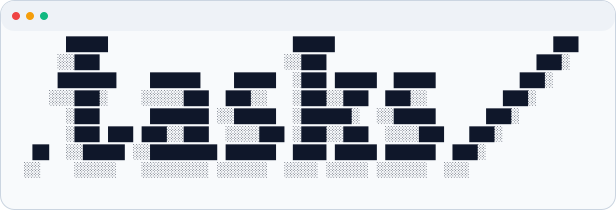

<p align="center">
  <picture>
    <source srcset="https://raw.githubusercontent.com/Awni00/dot-tasks/main/assets/logo/svg/banner-dark.svg" media="(prefers-color-scheme: dark)">
    <source srcset="https://raw.githubusercontent.com/Awni00/dot-tasks/main/assets/logo/svg/banner-light.svg" media="(prefers-color-scheme: light)">
    
  </picture>
</p>

<p align="center">
  <a href="https://github.com/Awni00/dot-tasks/actions/workflows/tests.yml"></a>
  <a href="https://github.com/Awni00/dot-tasks/actions/workflows/publish.yml"></a>
  <a href="https://pypi.org/project/dot-tasks/"></a>
  <a href="https://github.com/Awni00/dot-tasks/blob/main/LICENSE"></a>
</p>

<p align="center">
  <a href="#quick-start">Quick Start</a> •
  <a href="#installation">Install</a> •
  <!-- <a href="#commands">Commands</a> • -->
  <a href="#ai-agent-integration">AI Agent Integration</a> •
  <a href="#example-project">Example Project</a> •
  <a href="https://deepwiki.com/Awni00/dot-tasks">DeepWiki</a>
</p>

`dot-tasks` is a simple CLI for managing project-level tasks in a local `.tasks/` directory, using human- and agent-readable files.

It started as a personal workflow tool: keep task specs in files, let agents work from those specs, and keep progress records in the repo instead of chat history. It is shared here in case the same approach is useful to others.

dot-tasks keeps each task's metadata in `task.md` frontmatter (status, dates, dependencies, tags, a one-line summary, and whichever fields your project configures) and manages it through commands. The task description and any other files your project keeps in a task folder (plans, notes, session records) are edited directly, like ordinary files. Your project describes its own workflow in `.tasks/README.md`; the tool does not prescribe one.


## Quick Start

Quick start commands:

```bash
# Initialize .tasks/ dir in the current project
dot-tasks init
# Create a new todo task with a one-line summary and a priority; prints the task.md path.
dot-tasks create rename-variables-for-vibes summary="Refactor variable names for maximum vibes" priority=p1
# Move the task from todo/ to doing/.
dot-tasks start rename-variables-for-vibes
# Print the task folder (to open or add files there).
dot-tasks path rename-variables-for-vibes
# Mark the task complete and move it to done/.
dot-tasks complete rename-variables-for-vibes
```

### Task directory layout

```text
.tasks/
  README.md      # your project's workflow doc (starter written by `init`)
  config.yaml    # settings, including the task fields
  templates/
    task.md      # optional: the body new tasks start from
  todo/
  doing/
  done/
  trash/
```

Each task lives in `.tasks/<status-bucket>/<created-date>-<task_name>/`. The folder moves when the status changes, so refer to tasks by name or id, not by path (`dot-tasks path <task>` resolves one).

dot-tasks writes only `task.md`. Any other file in the folder (`plan.md`, `notes.md`, `sessions/…`) belongs to your project, and `dot-tasks view` lists it.

### `task.md`

```markdown
---
task_id: t-20261119-WF8R
task_name: prove-lemma-3
summary: Prove the variance bound in Lemma 3.
status: todo
date_created: '2026-11-19'
date_started: null
date_completed: null
depends_on: []
tags: [theory]
priority: p1
kind: theory
---

## Done when
- …
```

- **Frontmatter.** `task_id`, `task_name`, `status`, the dates, `depends_on` and `tags` are structural: they change only through commands (`create`, `start`, `complete`, `update --tag/--depends-on/--status`, `rename`). `summary` and the configured fields (here `priority` and a project-defined `kind`) are values: set them with `key=value` on `create`/`update`, or edit them by hand. Keys you add by hand are kept as written.
- **Body.** Free-form Markdown, written in your editor. `create` starts it from `.tasks/templates/task.md` if that file exists, otherwise it is empty. The CLI never edits the body after creation.

### Typical workflow:

| Step | What happens | Command(s) | Files touched |
| --- | --- | --- | --- |
| Make note of new to-do | Write down the task spec. Often I have an agent draft a spec from a rough note. | `dot-tasks create` | Creates task dir `.tasks/todo/<created-date>-<task_name>/` with `task.md` |
| Choose task to work on | Scan what is in `todo`/`doing` and pick the next task to start. | `dot-tasks list` | read-only inspection of `.tasks/` |
| Start active work | Move the task to active status when work begins. | `dot-tasks start` | Move task from `.tasks/todo/` to `.tasks/doing/` |
| Work loop | Edit the task description and the files your workflow keeps (plans, notes, records). | none, edit files directly | `task.md` body, project files in the task folder |
| Finish and archive state | Mark done when the work is finished, preserving its files. | `dot-tasks complete` | task directory moves to `.tasks/done/`|

## Installation

### Install via pip (PyPI)

```bash
pip install dot-tasks
```

Quick check:

```bash
dot-tasks --help
```

### Install Latest from GitHub

Install the latest from GitHub:

```bash
pip install "git+https://github.com/Awni00/dot-tasks.git"
```

### Development Install (with uv)

```bash
git clone https://github.com/Awni00/dot-tasks.git
cd dot-tasks
uv sync --dev
uv run dot-tasks --help
```

Editable install:

```bash
uv pip install -e ".[dev]"
```

## Commands

| Command | Purpose | Typical usage |
| --- | --- | --- |
| `init` | Create `.tasks/`, write/update managed config settings and a starter `.tasks/README.md` (if missing); can also append the dot-tasks section to AGENTS.md and install the skill via `npx skills`. | `dot-tasks init` |
| `install-skill` | Install the canonical `dot-tasks` skill via `npx skills`. | `dot-tasks install-skill [--yes]` |
| `add-agents-snippet` | Add or update the canonical `dot-tasks` section in AGENTS policy markdown. | `dot-tasks add-agents-snippet [--agents-file <path>] [--yes]` |
| `create` | Add a new task to `todo/` and print the path of its `task.md`. | `dot-tasks create <task_name> [summary="..."] [field=value ...] [--tag <tag>] [--depends-on <task>]` |
| `start` | Move a task to `doing/` (checks dependencies; `--force` overrides). | `dot-tasks start <task_name>` |
| `complete` | Move a task to `done/`. | `dot-tasks complete <task_name>` |
| `list` | List tasks by status, field and tag filters (rich/plain/JSON depending on context). | `dot-tasks list [todo|doing|done|all] [field=value ...] [--tag <tag> ...] [--json]` |
| `tags` | Show task counts by tag with optional status filter (rich/plain/JSON depending on context). | `dot-tasks tags [todo|doing|done] [--sort count|name] [--json]` |
| `view` | Show full details for one task, including clickable links to `task.md` and every other file in its folder. | `dot-tasks view <task_name> [--json]` |
| `path` | Print the absolute path of a task's folder. | `dot-tasks path <task_name>` |
| `graph` | Visualize task dependencies as a DAG in terminal output (`tree` or `layers` modes). | `dot-tasks graph [--mode tree|layers] [--include-done]` |
| `update` | Update the summary, fields, tags, dependencies or status (interactive form when no changes are given). | `dot-tasks update <task_name> [field=value ...] [field= ...] [--tag <tag>] [--depends-on <task>] [--status ...]` |
| `rename` | Rename a task. | `dot-tasks rename <task_name> <new_task_name>` |
| `delete` | Move a task to `trash/`, or delete permanently with `--hard`. | `dot-tasks delete <task_name> [--hard]` |

Interactive `create` and interactive `update` use a single tag selector flow with an optional `+ add new tag(s)` path.

Status filter supports `todo|doing` style multi-select and `all`. Default is `todo|doing`.

### Task fields

Fields are set and filtered with `key=value`; `key=` clears a field (or, in `list`, matches tasks where it is unset):

```bash
dot-tasks create prove-lemma-3 summary="Prove the variance bound in Lemma 3." priority=p1 kind=theory
dot-tasks update prove-lemma-3 due_date=2026-12-01
dot-tasks update prove-lemma-3 due_date=
dot-tasks list all kind=theory kind=writing     # same key twice: either value
dot-tasks list priority=p0 due_date=            # different keys: all must match
```

A project chooses its fields in `.tasks/config.yaml`. An entry is either the name of a built-in field or a definition with a `type` (`choice`, `date` or `text`):

```yaml
settings:
  fields:
    - priority                 # built-in: choice p0, p1, p2, p3 (default p2)
    - due_date                 # built-in: date
    - name: kind               # project-defined
      type: choice
      values: [theory, experiment, writing, literature]
    - name: effort             # built-in, overridden
      values: [hours, days, weeks]
      default: days
```

- **Built-ins:** `priority` (choice p0–p3, default p2, colour-ranked), `effort` (choice s/m/l/xl, default m), `due_date` (date), `owner` (text). A config without `fields` uses all four; a new `init` selects `priority`, `effort` and `due_date`.
- **Types:** `choice` values come from `values`; `ranked: true` colours the first values (as for `priority`). `date` values are `YYYY-MM-DD`; past dates on open tasks are highlighted red, today's orange, and the interactive date picker uses left/right for year/month/day and up/down to change them. `text` is free text.
- **Validation:** setting an unknown field or an invalid value fails with the allowed choices. A stored value that no longer fits (for example after you rename a choice) is reported as a warning on each command and left in place.
- **List columns:** any configured field, `summary`, `task_name`, `task_id`, `status`, `deps`, `created` and `completed` can be a column in `settings.list_table.columns`.

Tag examples:

```bash
dot-tasks list --tag bug
dot-tasks list todo|doing --tag backend --tag api --all-tags
dot-tasks list all
dot-tasks tags
dot-tasks tags todo --sort name
```

## AI Agent Integration

`dot-tasks` is designed so humans and agents can work from the same file-based task state in `.tasks/` instead of relying on chat context.

The pieces:

- **`.tasks/README.md`**: your project's workflow doc. It says when to create tasks, which files a task keeps (e.g. `plan.md`, per-session AI-use records), what to record when wrapping up and before completing. `init` writes a starter skeleton; edit it to fit the project.
- **AGENTS.md section**: a short trigger that tells agents the project uses dot-tasks and to read `.tasks/README.md` before working on a task.
- **`dot-tasks` skill**: a compact command and data-model reference.

The CLI itself never prints workflow guidance, so commands stay the same for humans and agents.

You can set up agent integration pieces either during `dot-tasks init` or with standalone commands:

- During `dot-tasks init` (interactive flow), `dot-tasks` can optionally append the AGENTS section and install the skill.
- Standalone commands:

```bash
dot-tasks install-skill
dot-tasks install-skill --yes
dot-tasks add-agents-snippet
dot-tasks add-agents-snippet --agents-file TEAM_AGENTS.md --yes
```

## Project workflow doc

`.tasks/README.md` is plain Markdown that you own. A research project might say:

```markdown
## Files in a task folder
- `task.md` body: starts from `.tasks/templates/task.md` (Done when, Outcome, Human review).
- `sessions/<date>-<session-id>.md`: one AI-use record per session (model, who did what,
  outcome, initial and major prompts), written at wrap-up from `.tasks/templates/session.md`.

## Before completing a task
- Fill Outcome and Human review. Abandoned work is completed with an explanatory Outcome
  and the `dropped` tag.
```

Its body template, `.tasks/templates/task.md`, puts reminders where the agent writes:

```markdown
## Done when

## Outcome
<!-- Filled at wrap-up. Abandoned work: explain why and tag `dropped`. -->

## Human review
```

## Migrating from 0.1

0.2.0 removes the workflow the tool used to hardcode and makes the task format configurable. It is not backward compatible on the command line:

- **Files:** `start` no longer creates `plan.md`, and no command writes `activity.md`. Existing `plan.md` and `activity.md` files stay in their task folders as ordinary files.
- **Commands:** `log-activity` is removed. `--priority`, `--effort`, `--owner`, `--due-date`, `--clear-due-date`, `--summary` and `--spec-readiness` are replaced by `key=value` arguments (`priority=p1`, `due_date=`, `summary="..."`).
- **Fields:** `spec_readiness` is no longer a field (existing values stay in the files as custom keys). `blocked_by` is no longer stored; `view` shows the same information as `blocks`. The summary is a frontmatter field; old tasks keep their `## Summary` body section.
- **Settings:** `settings.task_body_sections` and `settings.due_dates` are replaced by `.tasks/templates/task.md` and `settings.fields`. Run `dot-tasks init` once: it moves your body sections into the template (except Summary) and removes the retired settings.
- **New:** `dot-tasks path <task>`, configurable typed fields, `list` field filters, and a starter `.tasks/README.md` from `init`.

To refresh agent instructions, run `dot-tasks add-agents-snippet` and `dot-tasks install-skill`, then write your workflow in `.tasks/README.md`.

## Example Project

For a full demo of the workflow, see [`examples/basic-demo/`](examples/basic-demo/) and the walkthrough in [`examples/basic-demo/README.md`](examples/basic-demo/README.md).
